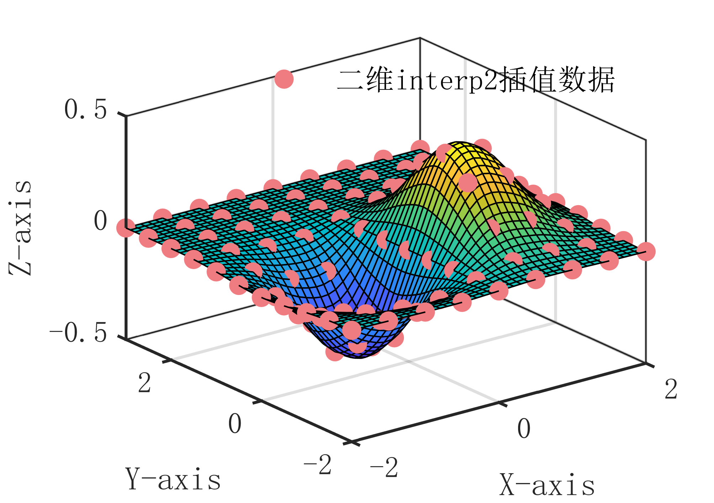

# MATLAB | Interpolation Algorithm | Two-Dimensional Interp2 Interpolation Method | Includes data and plotting code | Directly Useable

1. Basic Definition: The principle of the two-dimensional interpolation algorithm is to calculate the function value at any point by interpolation given known discrete data points in two dimensions. The specific algorithm steps are as follows:
Input a set of known two-dimensional discrete data points, where  and  are the independent variables, and  is the dependent variable.
Sort the data points according to   and   values in ascending order.
For the given interpolation points, find the interpolation intervals  and , such that
Using the two-dimensional plane between known points as an interpolation function, that is, calculating the function value of the interpolated point according to the formula.
Output the function values at the interpolation points. The core idea of the two-dimensional interpolation algorithm is to perform a two-dimensional plane interpolation between known two-dimensional data points, using the known points to estimate the function value of the unknown point. Compared to one-dimensional interpolation algorithms, the entire algorithm process is more complex, but it remains a simple and easy-to-understand, fast interpolation method. Of course, if there are nonlinear relationships between the data points, higher-order interpolation methods need to be used to achieve higher interpolation accuracy.
2. Definition and rendering effects, as shown below:
\n        \n  
Video tutorial operation:
\n        \n          \n          \n          \n          \n            To view this video please enable JavaScript, and consider upgrading to a\n            web browser that\n            supports HTML5 video\n  

## Images

<!-- PAYMENT_BLOCK -->

## Get this dataset

- Payment link (Stripe): [Buy now](https://buy.stripe.com/3cs8yP7sY87d0vu9AB)
- Payment QR code: 

<!-- /PAYMENT_BLOCK -->
